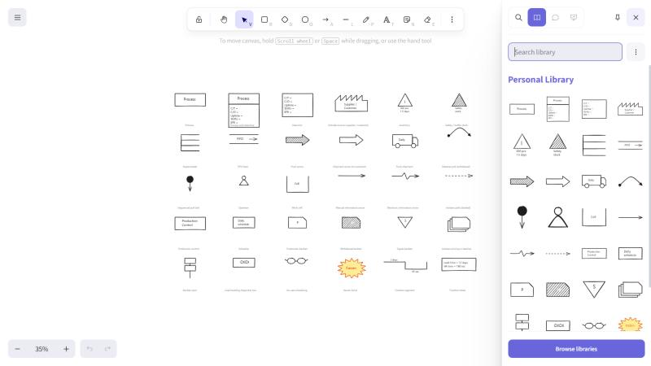
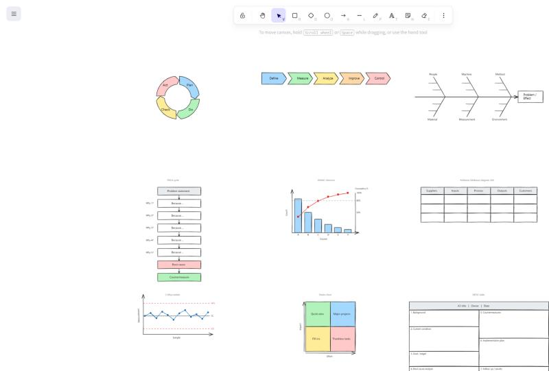
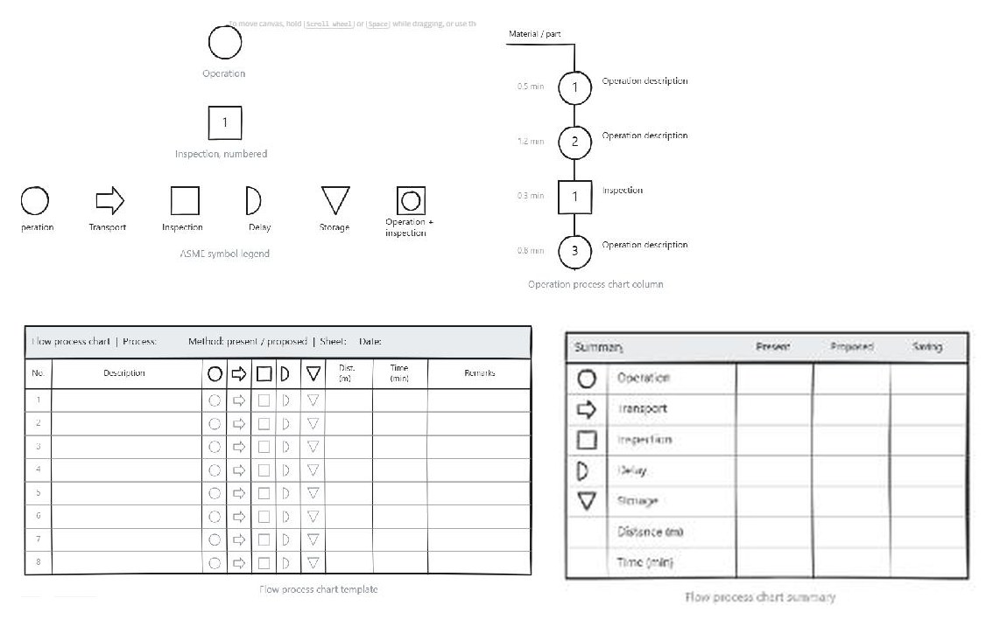
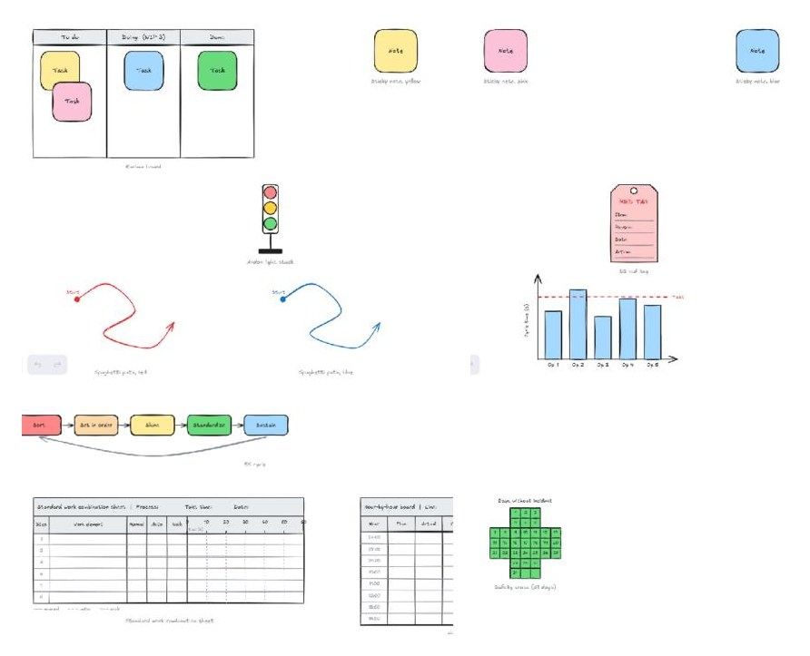

# Excalidraw Lean Six Sigma libraries

Hand-drawn style [Excalidraw](https://excalidraw.com) symbol libraries for
industrial engineering and Lean Six Sigma work: value stream mapping symbols,
and the standard problem-solving charts (PDCA, DMAIC, fishbone, 5 Whys,
Pareto, SIPOC, control chart, impact/effort matrix, A3).

Every item is grouped so it drops onto the canvas as one unit. Boxes use bound
text, so double-click edits the label in place. Ungroup (Ctrl+Shift+G) when you
want to restyle a template.

## Install

1. Download the library file you want:
   - [value-stream-mapping.excalidrawlib](https://raw.githubusercontent.com/ROBEAZY/excalidraw-lean-libraries/main/libraries/value-stream-mapping.excalidrawlib) (30 items)
   - [lean-six-sigma-charts.excalidrawlib](https://raw.githubusercontent.com/ROBEAZY/excalidraw-lean-libraries/main/libraries/lean-six-sigma-charts.excalidrawlib) (9 items)
2. Open [excalidraw.com](https://excalidraw.com) and click the **Library**
   button (book icon, top right).
3. Open the panel's menu (three dots next to the search box) and choose
   **Open**, then pick the downloaded file. The items are added to your
   personal library and persist in the browser.

The same files work in the Obsidian Excalidraw plugin and in self-hosted
Excalidraw.

Excalidraw's one-click `addLibrary` links only accept files hosted on
excalidraw.com or in the official `excalidraw/excalidraw-libraries` repo, so
there is no one-click link for this repo. Once a library here is accepted into
the public catalogue at https://libraries.excalidraw.com, install it from
there with one click.

## Value Stream Mapping

`libraries/value-stream-mapping.excalidrawlib`, following the conventions in
Rother and Shook, *Learning to See*.



- **Material and process flow:** Process, Process with data box, Data box,
  Outside source (supplier / customer), Inventory, Safety / buffer stock,
  Supermarket, FIFO lane, Push arrow, Shipment arrow (to customer),
  Truck shipment, Material pull (withdrawal), Sequenced pull ball, Operator,
  Work cell.
- **Information flow:** Manual information arrow, Electronic information arrow,
  Kanban path (dashed), Production control, Schedule, Production kanban,
  Withdrawal kanban, Signal kanban, Kanban arriving in batches, Kanban post,
  Load levelling (heijunka) box, Go-see scheduling.
- **General:** Kaizen burst, Timeline segment, Timeline totals.

## Lean Six Sigma charts

`libraries/lean-six-sigma-charts.excalidrawlib`. Templates with placeholder
text; edit labels in place or ungroup to rearrange.



- PDCA cycle (Plan, Do, Check, Act ring)
- DMAIC chevrons (Define, Measure, Analyze, Improve, Control)
- Fishbone (Ishikawa) diagram with the 6M categories
- 5 Whys ladder, from problem statement to root cause and countermeasure
- Pareto chart with cumulative line and 80 % marker
- SIPOC table
- Control chart with UCL, CL and LCL
- Impact / effort matrix
- A3 problem-solving template (seven boxes)

## ASME flow process chart

`libraries/asme-flow-process-chart.excalidrawlib`. The five ASME process
chart symbols used in method study and process analysis, plus the chart
templates built from them.



- Operation (circle), also numbered
- Transport (arrow)
- Inspection (square), also numbered
- Delay (D)
- Storage (triangle)
- Combined operation and inspection
- ASME symbol legend
- Flow process chart template: header block, eight rows with the five
  symbols in each row ready to be joined by a flow line, distance, time and
  remarks columns
- Flow process chart summary: present vs proposed counts per activity,
  distance and time
- Operation process chart column: material entry line, numbered operations
  and an inspection on a vertical flow line

## Lean workplace

`libraries/lean-workplace.excalidrawlib`. Visual management and shop-floor
lean tools.



- Kanban board with To do / Doing (WIP) / Done columns and sticky notes
- Sticky notes in yellow, pink and blue
- Andon light stack
- 5S red tag
- 5S cycle (Sort, Set in order, Shine, Standardize, Sustain)
- RAG status indicators
- Spaghetti diagram paths in red and blue, with start marker
- Workstation with operator position
- Operator balance chart (cycle time per operator against takt time)
- Standard work combination sheet with a time scale
- Hour-by-hour production board
- Safety cross with 31 day cells

## Previews

`previews/*.excalidraw` are ordinary Excalidraw scenes with every item laid out
in a grid. Open one at excalidraw.com to inspect the shapes at full size.

## Building

The libraries are generated by small Python scripts, so a shape fix is a code
change rather than a redraw.

```bash
python tools/build_vsm.py .
python tools/build_charts.py .
```

Each script writes the library file and the preview scene, then validates the
result: library format version 2, unique item names, one group per item, and
every text binding resolving inside its item.

## Contributing

Issues and pull requests are welcome. Keep items generic, in English, grouped,
and useful to more than one person. Libraries from this repo are also submitted
to the public Excalidraw catalogue at https://libraries.excalidraw.com.

## License

MIT. See `LICENSE`.
